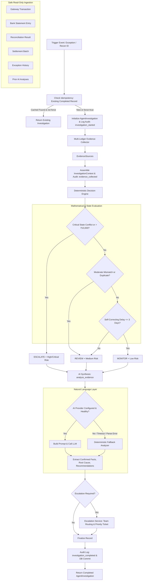

# AI Reconciliation Investigation Agent Architecture

> **Autonomous Multi-Ledger Investigation, Deterministic Decision Rules, and Natural Language Synthesis**

---

## 1. Overview

The **AI Reconciliation Investigation Agent** (Step 7) acts as an autonomous finance operations assistant. It ingests triggers from payment exceptions and reconciliation anomalies, aggregates corroborating evidence across multiple financial ledgers, evaluates risk and disposition through deterministic rules (`MONITOR`, `REVIEW`, `ESCALATE`), synthesizes natural language explanations via an LLM or offline fallback, and routes escalations with full audit provenance.

---

## 2. Core Architectural Principles & Invariants

1. **Deterministic Financial Truth**:
   The reconciliation matching engine is the sole source of financial truth. The agent's decision engine uses strict mathematical and rule-based thresholds. The LLM is used **strictly for narrative synthesis, confirmed fact formatting, and natural language explanation**.
2. **Strict Non-Mutability**:
   The agent is strictly read-only on all core financial tables (`transactions`, `bank_transactions`, `reconciliation_results`, `settlements`). It **never** alters transaction amounts, modifies matching statuses, executes refunds, generates ledger entries, or performs money movement.
3. **Multi-Ledger Evidence Corroboration**:
   Before reaching any conclusion, the agent collects corroborating evidence from 6 distinct sources:
   - Originating Gateway Transaction
   - Destination Bank Statement Credit/Debit
   - Reconciliation Result Record
   - Settlement Batch Records
   - Related Exception Ticket History
   - Historical AI Analyses
4. **Resilient Offline Fallback**:
   If the LLM provider is unconfigured, times out, or returns malformed data, the agent automatically falls back to deterministic rule-based analysis without error.
5. **Multi-Merchant Isolation**:
   Merchant users are strictly isolated to their own records. Admin users have cross-merchant visibility.

---

## 3. End-to-End Investigation Lifecycle

---

## 4. Deterministic Decision Engine Matrix

| Scenario / Condition | Agent Decision | Risk Level | Confidence | Escalation Team |
|---|---|---|---|---|
| Gateway Success + Bank Reversed/Failed | `ESCALATE` | `CRITICAL` | 0.95 | Payment Operations |
| Unreconciled Variance > ₹10,000 | `ESCALATE` | `CRITICAL` | 0.95 | Finance Operations |
| Duplicate Transaction Reference | `ESCALATE` | `HIGH` | 0.92 | Risk Team |
| Critical / High Severity Exception | `ESCALATE` | `HIGH` | 0.90 | Finance Operations |
| Missing in Bank Statement (> 3 days) | `REVIEW` | `HIGH` | 0.90 | Finance Operations |
| Amount Discrepancy (₹0 < variance <= ₹10,000) | `REVIEW` | `MEDIUM` | 0.88 | Finance Operations |
| Unresolved Ambiguous Candidate Match | `REVIEW` | `MEDIUM` | 0.85 | Finance Operations |
| Technical / Data Format Anomaly | `ESCALATE` | `HIGH` | 0.90 | Engineering |
| Merchant Onboarding / KYC Missing Ref | `REVIEW` | `MEDIUM` | 0.85 | Merchant Support |
| Settlement Clearing Delay (<= 3 days) | `MONITOR` | `LOW` | 0.85 | None |

---

## 5. Security & Isolation Boundaries

- **Authentication**: JWT token required (`Authorization: Bearer <token>`) on all endpoints.
- **Role-Based Permissions**:
  - `admin`: Full cross-merchant investigation querying, filtering, and execution.
  - `finance` / `merchant`: Scoped strictly to permitted merchant IDs via row-level SQLAlchemy filter clauses.
- **Audit Trails**: Every lifecycle stage appends an immutable record to the `audit_logs` table (`investigation_started`, `evidence_collected`, `escalation_created`, `investigation_completed`, `investigation_failed`).
- **Data Protection**: PII/PAN fields are never logged into structured telemetry or passed into external LLM prompts.

---

## 6. API Reference

| Method | Endpoint | Description |
|---|---|---|
| `POST` | `/api/agents/investigate/exception/{exception_id}` | Trigger or retrieve autonomous investigation for an exception |
| `POST` | `/api/agents/investigate/reconciliation/{reconciliation_id}` | Trigger or retrieve autonomous investigation for a recon result |
| `GET` | `/api/agents/investigations` | List investigations with pagination & multi-field filters |
| `GET` | `/api/agents/investigations/{id}` | Get single investigation by ID |
| `GET` | `/api/agents/investigations/{id}/evidence` | Retrieve raw multi-ledger evidence ledger |
| `GET` | `/api/agents/investigations/{id}/escalation` | Retrieve team routing ticket and recommended next action |
