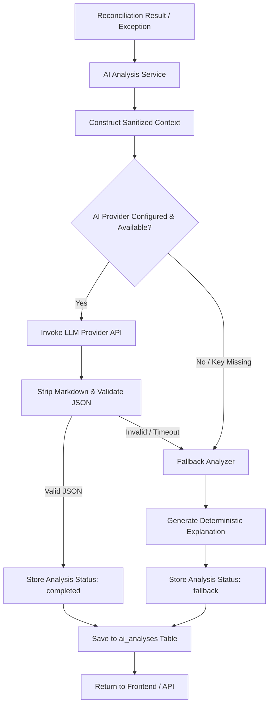

# AI Mismatch Analysis & Investigation Architecture

> **Step 6: AI-Powered Explanation & Root-Cause Analysis Layer**

The AI Mismatch Analysis layer provides human-readable explanations, root-cause diagnostics, risk/severity reasoning, and recommended next actions for reconciliation exceptions.

---

## 1. Architectural Philosophy: Deterministic Truth vs. Interpretive AI

A foundational principle of this financial platform is the strict separation between **financial truth** and **AI interpretation**:

```
[ Financial Ingestion / Ledgers ]
               ↓
[ Deterministic Reconciliation Engine ]  <-- SOURCE OF FINANCIAL TRUTH
               ↓ (Produces match status & exceptions)
[ Reconciliation Results & Exceptions ]
               ↓
    [ AI Analysis Layer ]                <-- INTERPRETIVE / ADVISORY ONLY
               ↓
[ AI Analysis Database & Frontend ]
```

### Critical Domain Constraints:
- **AI MUST NOT** change reconciliation status (`matched`, `amount_mismatch`, `unresolved`, etc.).
- **AI MUST NOT** change transaction amounts, currencies, or dates.
- **AI MUST NOT** automatically mark transactions as matched or resolve exception tickets.
- **AI MUST NOT** create financial transactions, refunds, or reversals.
- **AI ONLY** interprets and explains existing deterministic reconciliation results.

---

## 2. End-to-End Analysis Workflow



### Analysis Data Flow:
1. **Reconciliation Result / Exception**: Controller requests analysis from dashboard or API.
2. **Context Construction**: The backend loads transaction, bank transaction, reconciliation outcome, and exception records. Context is sanitized—no JWT tokens, passwords, or PII are ever forwarded.
3. **AI Provider Call**: Prompt is dispatched with domain safety constraints and structured JSON schema expectations.
4. **Response Validation**: Raw text is cleaned, JSON parsed, values bounded, and risk levels normalized.
5. **Database Persistence**: Saved to `ai_analyses` table with full provenance (provider, model, timestamp, status, raw response).
6. **Frontend**: Displayed with clear indicators. If fallback was used, the UI prominently displays: `"AI unavailable — rule-based analysis provided."`

---

## 3. Deterministic Fallback Analyzer (`fallback_analyzer.py`)

The application is guaranteed to never return HTTP 500 when external AI APIs are down or unconfigured. 

Fallback triggers on:
- Missing `AI_API_KEY`
- Network connection error or DNS resolution failure
- Timeout exceeding `AI_TIMEOUT_SECONDS` (default: 30s)
- HTTP error responses from LLM provider (429, 500, etc.)
- Malformed or non-JSON output from LLM

The fallback analyzer evaluates deterministic fields:
- `match_status`
- `difference_amount`
- `matching_method`
- Transaction dates & timestamps
- Transaction statuses (Gateway vs Bank)
- Exception categories and severities

Output records have:
```json
{
  "status": "fallback",
  "ai_provider": "fallback",
  "model_name": "rule-based-fallback-v1"
}
```

---

## 4. Supported Anomaly Categories

| Discrepancy Category | Possible Root Causes Evaluated | Risk Level | Controller Next Step |
|---|---|---|---|
| **Amount Mismatch** | Processing fees, MDR deduction, partial capture, refund, currency rounding | Medium / High | Verify processor fee schedule against bank credit entry |
| **Missing in Bank** | Settlement cycle lag (T+1/T+2), bank holiday, gateway payout failure | High | Check payout batch UTR in gateway admin console |
| **Missing in Gateway** | Direct customer NEFT/RTGS wire, dropped webhook, unmapped terminal | High | Inspect bank statement narration for customer ID |
| **Duplicate Transaction** | Repeated file upload, duplicate webhook callback, accidental double-charge | High | Check upload batch files; freeze duplicate disbursement |
| **Settlement Delay** | Processor batching schedule, holiday liquidity hold | Low | Verify contractual SLA; confirm ledger once posted |
| **Status Mismatch** (e.g. Gateway SUCCESS vs Bank FAILED) | Post-auth reversal, chargeback dispute, technical settlement drop | **Critical** | **Immediate escalation**; halt fulfillment/disbursement |
| **Unresolved / Ambiguous** | Multiple identical amount candidates, missing reference mappings | Medium | Manual human review; do not automate |

---

## 5. API Endpoints

All AI routes are under `/api/ai` and require `finance_user` or `admin` authentication.

| Method | Route | Description |
|---|---|---|
| `POST` | `/api/ai/analyze/{reconciliation_id}` | Analyze reconciliation result (`?force=false` by default) |
| `POST` | `/api/ai/analyze/exception/{exception_id}` | Analyze a specific exception ticket |
| `POST` | `/api/ai/investigate/{exception_id}` | Deep diagnostic investigation with checklist |
| `GET` | `/api/ai/analyses` | Paginated list of analyses with filters (`status`, `risk_level`) |
| `GET` | `/api/ai/analyses/{analysis_id}` | Retrieve single analysis by ID |
| `GET` | `/api/ai/analyses/reconciliation/{reconciliation_id}` | Full history of analyses for a reconciliation |

### Duplicate Prevention:
- If an analysis already exists for the given target and analysis type, calling `POST /api/ai/analyze/...` returns the existing record immediately without calling the AI provider again.
- Passing `?force=true` forces a fresh analysis and appends a new record to the audit history.

---

## 6. Environment Configuration

| Variable | Default | Description |
|---|---|---|
| `AI_API_KEY` | `""` | API key for external LLM provider (e.g. Gemini) |
| `AI_SERVICE_URL` | `""` | Optional proxy or custom LLM gateway URL |
| `AI_TIMEOUT_SECONDS` | `30` | Max wait time before switching to deterministic fallback |
| `AI_MODEL_NAME` | `gemini-1.5-flash` | Target model name |

---

## 7. Security & Auditability

1. **Untrusted Input**: Output from the LLM is treated as untrusted input and validated via Pydantic and JSON parsing.
2. **No Secret Leakage**: `AI_API_KEY`, `JWT_SECRET`, and database credentials are never logged or passed to the LLM.
3. **No Code Execution**: AI-generated suggestions are never executed as dynamic code or raw SQL queries.
4. **Append-Only History**: Historical AI analyses are preserved in `ai_analyses` for regulatory auditability.
