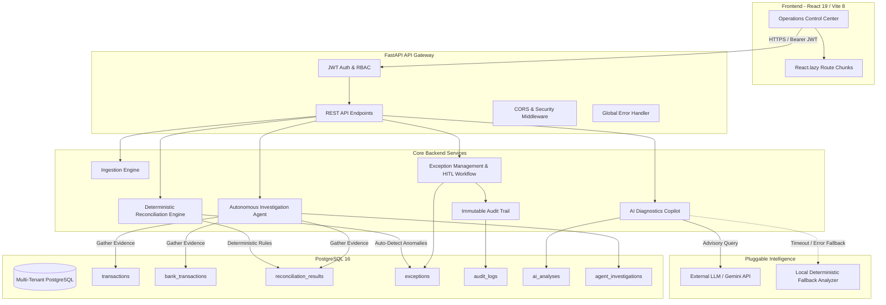

# System Architecture & Technical Design

> **AI-Powered Payment Reconciliation & Exception Management Agent**  
> *Production-Ready Multi-Tenant Financial Architecture*

This document provides a comprehensive technical overview of the system architecture, component boundaries, data flows, and strict financial invariants.

---

## 1. Architectural Philosophy & Invariants

Financial systems require non-negotiable correctness, determinism, and auditability. The platform is architected around four core principles:

1. **Deterministic Financial Truth**: Reconciliation decisions (matched, partial match, amount mismatch, duplicate, missing) are strictly computed by deterministic rule-based algorithms. **LLMs are never permitted to modify financial ledger amounts, alter match outcomes, or execute bank movements.**
2. **AI as an Interpretive Copilot**: Machine learning and LLMs are strictly bounded to interpretive roles: synthesizing multi-ledger narratives, explaining probable root causes (e.g., standard fee deductions, forex slippage), and drafting operator recommendations.
3. **Human-in-the-Loop Final Authority**: Critical and high-variance exceptions require human operator review and explicit resolution notes. Resolved tickets are terminally protected against silent modification.
4. **Tamper-Evident Auditability**: Every state transition, operator assignment, review note, and reconciliation execution writes an immutable record to the `audit_logs` table.

---

## 2. High-Level Component Diagram



---

## 3. Layer Breakdown

### A. Presentation Layer (Frontend)
- **Framework**: React 19 + Vite 8.
- **Styling**: Tailwind CSS v4 design tokens with high-contrast slate theme, badge variants, and glassmorphic panels.
- **Performance & Code Splitting**: All page routes (`/dashboard`, `/transactions`, `/reconciliation`, `/exceptions`, `/agent`, `/ai-analysis`, `/import`, `/settlements`, `/merchants`) are dynamically imported using `React.lazy` and wrapped in `React.Suspense`.
- **Bundle Optimization**: All individual JavaScript bundles are maintained under 400 kB with zero Vite chunk warnings.
- **State & Communication**: Axios API client with automatic JWT bearer token injection, HTTP 401 interceptors, and typed response formatting.

### B. API & Security Layer (Backend)
- **Framework**: FastAPI (Python 3.12/3.14 compatible).
- **Authentication**: Stateless JSON Web Tokens (JWT) signed using `HS256`. Tokens carry user ID, email, and role.
- **Role-Based Access Control (RBAC)**:
  - `admin`: Full administrative access, tenant creation, and demo data loading (`POST /api/demo/load-sample-data`).
  - `finance_user`: Day-to-day operations, transaction upload, reconciliation execution, exception assignment, and resolution.
- **Tenant Isolation**: Every merchant-scoped transaction, settlement, exception, and reconciliation run enforces `merchant_id` verification. Non-admin users cannot access cross-tenant financial records.
- **Standardized Error Handling**: Unhandled exceptions return safe, uniform JSON error responses (`{"detail": "..."}`) without leaking internal database or system stack traces.

### C. Ingestion & Normalization Engine
- Ingests tabular financial files in **CSV** and **XLSX** formats.
- Pre-configured parsers for payment gateways (**Razorpay**, **Stripe**, **Paytm**) and core banking statements (**HDFC**, **ICICI**, **SBI**, **Axis**).
- **Data Sanitization**: Strips leading/trailing whitespaces, standardizes dates into UTC ISO-8601, and maps currency codes.
- **Deduplication**: Rejects duplicate reference records at the ingestion boundary using unique constraints and batch tracking.

### D. Deterministic Reconciliation Engine
Reconciliation executes through a strict 3-tier matching hierarchy:

```mermaid
graph TD
    Start[Transaction Ingested] --> Tier1{Tier 1: Exact Match?}
    Tier1 -- Yes (Ref & Amount match) --> Matched[Status: MATCHED (Confidence: 1.0)]
    Tier1 -- No --> Tier2{Tier 2: Normalized Match?}
    
    Tier2 -- Yes (Alphanumeric Normalized Ref) --> CheckAmt{Amounts Match?}
    CheckAmt -- Yes --> MatchedNorm[Status: MATCHED (Confidence: 0.95)]
    CheckAmt -- No --> AnomalyAmt[Status: AMOUNT_MISMATCH]
    
    Tier2 -- No --> Tier3{Tier 3: Amount + Date Tolerance?}
    Tier3 -- Yes (Within ±1 Day, Unique Candidate) --> MatchedTol[Status: PARTIAL_MATCH (Confidence: 0.85)]
    Tier3 -- No --> AnomalyMissing[Status: MISSING_IN_BANK / MISSING_IN_GATEWAY]

    AnomalyAmt --> CreateException[Create PaymentException]
    AnomalyMissing --> CreateException
```

- **Idempotent Runs**: Repeated reconciliation runs update existing result rows rather than creating duplicate entries.

### E. AI Diagnostics & Autonomous Agent Service
- **AI Mismatch Analysis**: Generates natural language root-cause explanations and actionable verification checklists for operators.
- **Zero-Failure Fallback Guarantee**: If the configured LLM API times out (>30s) or fails, the service transparently switches to `fallback_analyzer.py`. This deterministic local analyzer evaluates variance thresholds, timing windows, and fee patterns to return instant diagnostics (`status="fallback"`). The API never yields an HTTP 500 error on AI downtime.
- **Autonomous Agent Service**:
  - Gathers corroborating evidence across 6 distinct database tables.
  - Applies deterministic risk scoring to recommend `MONITOR`, `REVIEW`, or `ESCALATE`.
  - Automatically routes tickets to specialized operational teams (`Finance Operations`, `Payment Operations`, `Risk Team`, `Engineering`).

### F. Exception Management & HITL Workflow Engine
- Implements a finite state machine:
  `open` → `investigating` → `resolved` or `ignored`
- **Mandatory Review Notes**: Resolving an exception strictly requires a non-empty `resolution_note`. Ignoring an exception strictly requires a `reason`.
- **Terminal State Protection**: Once an exception is marked `resolved` or `ignored`, its fields are locked against accidental changes. Reopening requires a dedicated supervisor action (`POST /{id}/reopen`).
- **Grounded 360° Inspector**: Aggregates related transactions, bank statement items, AI analyses, agent evidence, and chronological event logs into a unified view.

---

## 4. Database Schema & Financial Precision

All monetary fields are stored as **`Numeric(18, 4)`** and handled as Python `decimal.Decimal` types. Floating-point types (`float`, `double`) are strictly prohibited in financial paths.

### Primary Entities

| Table | Primary Key | Critical Indexes | Description |
|---|---|---|---|
| `merchants` | `id` (UUID) | `email` | Multi-tenant merchant accounts |
| `users` | `id` (UUID) | `email` | Platform operators with RBAC roles |
| `transactions` | `id` (UUID) | `transaction_reference`, `merchant_id`, `transaction_date` | Gateway / order payment entries |
| `bank_transactions` | `id` (UUID) | `bank_reference`, `transaction_reference`, `transaction_date` | Bank statement credit/debit records |
| `settlements` | `id` (UUID) | `settlement_reference`, `merchant_id` | Processor settlement batches |
| `reconciliation_results` | `id` (UUID) | `transaction_id`, `bank_transaction_id`, `match_status` | Match outcomes and confidence scores |
| `exceptions` | `id` (UUID) | `reconciliation_id`, `merchant_id`, `status`, `severity` | Discrepancy tickets for human review |
| `audit_logs` | `id` (UUID) | `user_id`, `(entity_type, entity_id)`, `created_at` | Append-only immutable action trail |
| `ai_analyses` | `id` (UUID) | `reconciliation_id`, `exception_id` | Cached advisory AI explanations |
| `agent_investigations` | `id` (UUID) | `exception_id`, `reconciliation_id`, `status` | Autonomous agent evidence and decisions |
