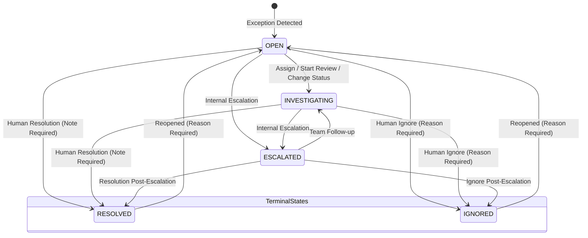
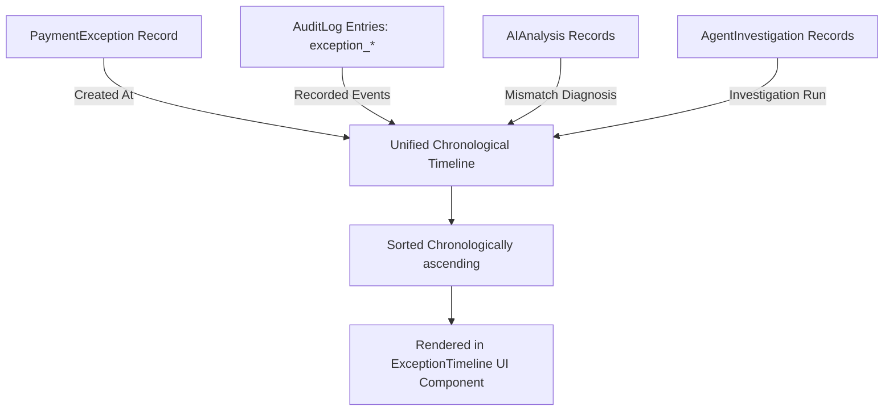

# Exception Management & Human-in-the-Loop Workflow

> **Production-Quality Exception Resolution, Human Review State Machine, Grounded Evidence Timeline, and Tamper-Resistant Audit Logging**

---

## 1. Overview & Core Philosophy

In payment reconciliation systems, automated engines and AI agents identify discrepancies, score risk, and hypothesize root causes. However, **financial finality demands human accountability**. 

**Step 9** establishes a production-grade **Exception Management and Human-in-the-Loop (HITL) Workflow** for the *AI-Powered Payment Reconciliation & Exception Management Agent*.

### The Core Guardrail
> [!IMPORTANT]
> **The AI Agent recommends actions; a human finance operator remains strictly responsible for final financial decisions.**
> Under NO circumstance does any workflow action modify transaction amounts, alter deterministic reconciliation decisions, execute money movement, trigger bank transfers, or tamper with immutable ledger records.

---

## 2. Workflow State Machine

The exception lifecycle is governed by an explicit, deterministic state machine with terminal state protection and reopening capabilities.



### State Definitions & Rules
1. **`open`**: The initial state when a reconciliation run identifies an anomaly (e.g. `amount_mismatch`, `missing_in_bank`, `duplicate`). The exception is awaiting triage or assignment.
2. **`investigating`**: A finance analyst is actively reviewing transaction ledgers, bank statements, and AI investigation results. Triggered automatically on assignment or manual status change.
3. **`resolved` (Terminal)**: A human operator has executed an operational fix (e.g., manual settlement adjustment, dispute filed, customer credited via external system). **Mandates a resolution note**. Once resolved, fields cannot be modified without reopening.
4. **`ignored` (Terminal)**: A human operator determined the discrepancy is acceptable (e.g., within contractual fee tolerance, known timing window, harmless rounding). **Mandates an ignore reason**.
5. **Reopening (`reopen`)**: Allows supervisors to reopen terminal (`resolved` or `ignored`) exceptions when new bank feeds or audits arrive. Re-clears terminal stamps, resets status to `open`, and mandates an audit-logged reason.
6. **Escalation**: Exceptions with `severity == 'critical'` or complex cross-ledger disputes can be marked as internally escalated, tracking `escalated_at` and `escalation_reason` without altering the financial ledger.

---

## 3. Grounded Exception Timeline

Rather than relying on ephemeral UI memory, the exception timeline is **grounded in immutable database records** across four distinct tables:



### Timeline Event Types
| Event Type | Source Table | Description |
| :--- | :--- | :--- |
| `created` | `PaymentException` | The initial discovery timestamp of the reconciliation mismatch. |
| `assigned` | `AuditLog` (`action="exception_assigned"`) | Exception assigned to an operator, or unassigned. |
| `status_changed` | `AuditLog` (`action="exception_status_changed"`) | Workflow status updated (`open` → `investigating`, etc.). |
| `reviewed` | `AuditLog` (`action="exception_reviewed"`) | Human reviewer added progress notes or hypotheses. |
| `escalated` | `AuditLog` (`action="exception_escalated"`) | Escalated to higher-tier team with reason. |
| `ai_analysis` | `AIAnalysis` | Autonomous mismatch diagnosis completed by Gemini / offline engine. |
| `investigation` | `AgentInvestigation` | Multi-ledger autonomous agent investigation synthesized. |
| `resolved` | `AuditLog` (`action="exception_resolved"`) | Human operator resolved the ticket with resolution notes. |
| `ignored` | `AuditLog` (`action="exception_ignored"`) | Human operator marked exception as ignored with rationale. |
| `reopened` | `AuditLog` (`action="exception_reopened"`) | Terminal exception reopened with supervisor explanation. |

---

## 4. Complete REST API Specifications

All endpoints are hosted under `/api/v1/exceptions` and enforce JWT authentication, RBAC, and merchant tenancy isolation.

| Method | Endpoint | Description | Request Body |
| :--- | :--- | :--- | :--- |
| `GET` | `/api/v1/exceptions` | Filtered list of exceptions (status, severity, search, date range, pagination) | Query params |
| `GET` | `/api/v1/exceptions/workflow-summary` | High-level metrics strip (`total`, `open`, `investigating`, `resolved`, `critical`, etc.) | None |
| `GET` | `/api/v1/exceptions/assignees` | Unique list of operators assigned to exceptions | None |
| `GET` | `/api/v1/exceptions/{id}` | Standard exception summary response | None |
| `GET` | `/api/v1/exceptions/{id}/details` | Full 360° projection: Transaction, Bank Txn, Reconciliation, AI Analysis, Agent Investigation | None |
| `GET` | `/api/v1/exceptions/{id}/timeline` | Unified chronological timeline of events | None |
| `POST` | `/api/v1/exceptions/{id}/assign` | Assign or reassign exception to a human operator | `{"assigned_to": "alice@company.com"}` |
| `POST` | `/api/v1/exceptions/{id}/status` | Update workflow status (`open`, `investigating`) with optional note | `{"status": "investigating", "note": "..."}` |
| `POST` | `/api/v1/exceptions/{id}/review` | Add reviewer notes while keeping exception in progress | `{"note": "Waiting for bank statement credit"}` |
| `POST` | `/api/v1/exceptions/{id}/resolve` | Mark exception as resolved with required resolution note | `{"resolution_note": "Manual fee credit verified"}` |
| `POST` | `/api/v1/exceptions/{id}/ignore` | Mark exception as ignored with required reason | `{"reason": "Difference within INR 1 tolerance"}` |
| `POST` | `/api/v1/exceptions/{id}/escalate` | Flag exception for internal escalation | `{"escalation_reason": "High-value mismatch"}` |
| `POST` | `/api/v1/exceptions/{id}/reopen` | Reopen a resolved or ignored exception | `{"reason": "New chargeback arrived"}` |

---

## 5. Audit Logging Invariants

Every single human and system transition writes an immutable row to `audit_logs`:
- **`user_id`**: The operator who initiated the action.
- **`merchant_id`**: The tenancy boundary of the underlying transaction.
- **`entity_type`**: `"exception"`.
- **`entity_id`**: UUID of the `PaymentException`.
- **`action`**: Standardized snake_case verb (`exception_assigned`, `exception_resolved`, etc.).
- **`details`**: Structured JSON payload containing previous states, new states, notes, and reasons.

---

## 6. Frontend Operations Workbench

The frontend provides a cohesive, interactive workspace for finance teams:

1. **Workflow Metric Strip**: Real-time counter cards showing total exceptions, active investigations, unassigned tickets, critical alerts, and resolved volume today.
2. **Interactive Filters**: Instant filtering by status (`open`, `investigating`, `resolved`, `ignored`), severity (`critical`, `high`, `medium`, `low`), search query, and assignment status.
3. **Exception Table**:
   - Clear visual status and severity badges.
   - Inline fast assignment drop-down.
   - Highlighting for critical or escalated exceptions.
4. **Slide-Out Details Inspector (360° View)**:
   - **Transaction vs. Bank Comparison Card**: Side-by-side display of amount, reference, date, and status.
   - **AI Analysis & Agent Investigation Cards**: Displays confidence scores, root-cause hypotheses, and suggested actions.
   - **Unified Grounded Timeline**: Interactive vertical timeline showing each event with author badges and relative timestamps.
   - **Human Review Action Center**: Tabbed interface to append review notes, execute resolutions, ignore false positives, or trigger escalations.
   - **Supervisor Reopen Action**: Available exclusively on resolved/ignored items to reinstate active investigation.

---

## 7. Verification & Automated Test Coverage

The Step 9 workflow is validated with 26 focused integration tests in [`backend/tests/test_api_exceptions_workflow.py`](file:///C:/Users/user/Desktop/p1/backend/tests/test_api_exceptions_workflow.py) across the entire 200-test backend suite:

```bash
# Run the complete test suite
pytest tests/
# Result: 200 passed, 0 failed in 7.91s
```

### Key Scenarios Covered
- Assignment and reassignment with audit log emission.
- Valid status transitions (`open` → `investigating`).
- Enforcing mandatory resolution notes on `/resolve`.
- Enforcing mandatory ignore reasons on `/ignore`.
- Terminal state protection (rejecting status modification on resolved exceptions).
- Supervisor reopening with terminal flag clearing.
- Grounded timeline aggregation from multi-table sources.
- Full 360° details projection including related transaction and bank data.
- Tenant data isolation between merchant and admin users.
